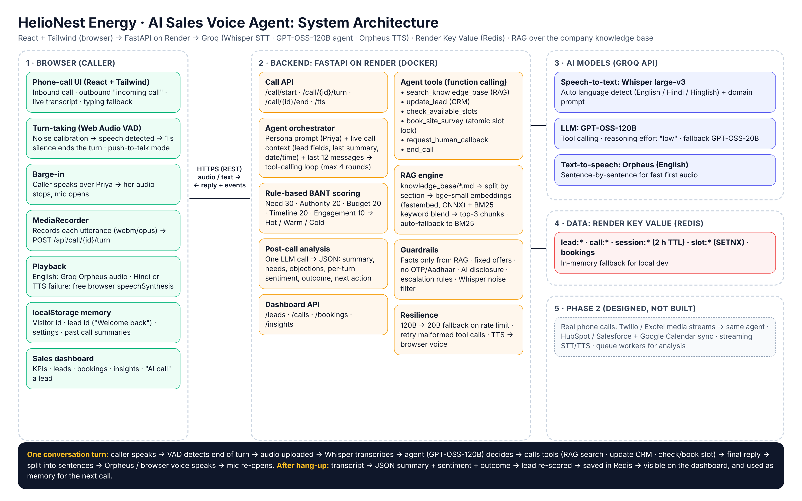

# HelioNest Energy: Autonomous AI Sales Voice Agent

A working prototype of an AI sales agent that **talks on a voice call**, answers from company documents (RAG),
**qualifies leads (BANT)**, **books site surveys**, updates a **CRM**, and gives managers **call summaries, sentiment and insights**.

> HelioNest Energy is a **fictional** rooftop-solar company created for this demo. Only the PM Surya Ghar subsidy rules are real.



- **1-page report:** [REPORT.md](REPORT.md)
- **Architecture diagram:** [docs/architecture.png](docs/architecture.png) (also as a PDF)
- **Lead scoring rules:** [docs/lead_scoring.md](docs/lead_scoring.md)
- **Demo script and interview notes:** [docs/demo_and_interview_notes.md](docs/demo_and_interview_notes.md)

## Features
| Requirement | How it is implemented |
|---|---|
| Real-time voice (STT + TTS) | Browser mic + voice-activity detection → Groq **Whisper large-v3** → reply spoken by Groq **Orpheus** (English) or the browser voice (Hindi) |
| Turn-taking & barge-in | Web Audio energy VAD (auto noise calibration, 1 s silence = end of turn), interrupt Priya by speaking, push-to-talk mode |
| Contextual memory | Short-term: last 12 messages. Long-term: lead record + last call summary in **Redis**, visitor identity in **localStorage** ("Welcome back!") |
| Multilingual | Whisper auto-detects English/Hindi/Hinglish; Priya replies in the caller's language |
| Lead qualification & sentiment | LLM extracts BANT facts via `update_lead`; **code** computes a 0–100 score → Hot/Warm/Cold; per-turn sentiment after the call |
| RAG knowledge retrieval | `knowledge_base/*.md` → section chunks → bge-small embeddings + BM25 → top-3 into the agent |
| Booking + CRM | `check_available_slots`, `book_site_survey` (atomic Redis lock), `update_lead`, `request_human_callback` |
| Summaries & insights | JSON summary, needs, objections, outcome, next action; dashboard with KPIs, conversion, sentiment, objections |
| Outbound calls | "Simulate a website enquiry" → Priya calls the lead back with context |

## Run locally (about 5 minutes)
Requirements: Python 3.10+, Node 18+, a free Groq API key (https://console.groq.com/keys).

```bash
# 1. Backend
cp .env.example .env            # Windows: copy .env.example .env   — then paste your GROQ_API_KEY
python -m venv .venv
source .venv/bin/activate       # Windows: .venv\Scripts\activate
pip install -r backend/requirements.txt
uvicorn app.main:app --app-dir backend --reload --port 8000

# 2. Frontend (new terminal)
cd frontend
npm install
npm run dev                      # open http://localhost:5173 and allow the microphone
```
Redis is optional locally: without `REDIS_URL`, data is kept in memory.

**Single-server mode** (like production): `cd frontend && npm run build`, then open http://localhost:8000.

## Deploy to Render (free)
1. Push this repo to GitHub (make sure `.env` is **not** committed).
2. Render → **New → Blueprint** → select the repo. It reads `render.yaml` and creates:
   - `helionest-voice-agent` (Docker web service, free)
   - `helionest-kv` (Key Value / Redis, free)
3. Paste `GROQ_API_KEY` when asked → Deploy (the first build takes a few minutes).
4. Open `https://<your-app>.onrender.com/api/health` and check `"groq_key_set": true`.

Notes: free instances **sleep when idle**, so open the site 2 minutes before the demo. If logs show out-of-memory, set `RAG_BACKEND=bm25`.
If Groq TTS returns an error about model terms, open the Orpheus model in the Groq console playground and accept its terms once. Until then, the app automatically uses the browser voice.

## Tests
```bash
pip install pytest httpx
python -m pytest backend/tests -q      # full call flow with Groq mocked (no key needed)
```

## Project structure
```
backend/app/
  main.py          FastAPI routes + serves the built frontend
  agent.py         persona prompt, call context, tool-calling loop, post-call summary
  tools.py         tool schemas + implementations (RAG, CRM, calendar, escalation)
  rag.py           knowledge-base chunking, embeddings + BM25 retrieval
  groq_client.py   Groq LLM (with fallback model), Whisper STT, Orpheus TTS
  scoring.py       rule-based BANT lead scoring
  store.py         Redis / in-memory storage
  insights.py      dashboard metrics + demo seed leads
frontend/src/
  lib/voice.js     mic, VAD turn-taking, barge-in, push-to-talk, TTS playback
  components/      CallView (phone UI + live CRM console), Dashboard, LeadPanels
knowledge_base/    company documents used for RAG
prompts/           Priya's system prompt + post-call summary prompt
docs/              architecture diagram, lead scoring, demo notes
```

## Free-tier limits to know
The Groq free tier caps GPT-OSS-120B at about 8K tokens per minute and 200K per day. The app keeps prompts small and switches to GPT-OSS-20B automatically when rate-limited.
Do practice calls with `LLM_MODEL=openai/gpt-oss-20b` and switch back to 120B for the real demo.
